<div align="center">



# ⚛️ Awesome Advanced Materials Discovery Platforms

[](https://github.com/ishandutta2007/Awesome-Awesome-Awesome)<a href="https://discord.gg/jc4xtF58Ve"></a>
[](https://github.com/ishandutta2007/Awesome-Advanced-Materials-Discovery-Platforms/stargazers)
[](https://github.com/ishandutta2007/Awesome-Advanced-Materials-Discovery-Platforms/network/members)
[](https://github.com/ishandutta2007/Awesome-Advanced-Materials-Discovery-Platforms/issues)
[](https://github.com/ishandutta2007/Awesome-Advanced-Materials-Discovery-Platforms/pulls)
[](LICENSE)
<a href="https://github.com/ishandutta2007"></a>

**A definitive, curated index of Enterprise SaaS Platforms, Autonomous Wet-Labs, and Open-Source GitHub Projects accelerating AI-driven Materials Informatics, Generative Crystal Design, Molecular Dynamics, Machine Learning Force Fields (MLFF), and Next-Generation Functional Materials Discovery.**

*Batteries • Catalysts • Semiconductors • Superconductors • Thermoelectrics • Structural Alloys • Polymers • Carbon Capture*

</div>

---

## 📑 Table of Contents

- [🔍 SEO & Taxonomy Keywords](#-seo--taxonomy-keywords)
- [🌐 Sector Overview & Market Dynamics](#-sector-overview--market-dynamics)
- [🏢 SaaS & Hosted Platforms](#-saas--hosted-platforms)
- [💻 Open-Source GitHub Projects](#-open-source-github-projects)
- [🏗️ Recommended Architecture & Custom Discovery Stack](#️-recommended-architecture--custom-discovery-stack)
- [📈 Star History](#-star-history)
- [☕ Support & Sponsorship](#-support--sponsorship)
- [🤝 How to Contribute](#-how-to-contribute)
- [🛡️ Disclaimer](#️-disclaimer)

---

## 🔍 SEO & Taxonomy Keywords

`materials-discovery` • `materials-informatics` • `materials-science` • `generative-ai` • `machine-learning-force-fields` • `density-functional-theory` • `crystal-structure-prediction` • `molecular-dynamics` • `self-driving-labs` • `high-throughput-screening` • `battery-materials` • `catalyst-design` • `computational-materials-science` • `ai-for-science` • `deepchem` • `pymatgen` • `mattergen` • `mace` • `gnome`

---

## 🌐 Sector Overview & Market Dynamics

- **Market Size & Projections**: The global AI-powered Materials Informatics and Discovery platform sector is valued at approximately **$170M to $210M in 2025** and is projected to surge to **$390M to $410M+ by 2030**, reflecting a rapid compound annual growth rate (**CAGR of 18.0% to 24.8%**). The broader computational materials simulation, quantum chemistry, and molecular modeling market surpasses **$2.8B**.
- **Market Structure & Fragmentation**: The sector is **moderately fragmented** rather than a pure winner-take-all monopoly. While incumbent computational modeling powerhouses (*Schrödinger*, *Dassault Systèmes BIOVIA*) and mega-funded AI spinouts (*SandboxAQ*, *Citrine Informatics*) capture large multi-year enterprise contracts, high technical specialization preserves independent domain champions. Sub-verticals—such as solid-state battery electrolytes (*Aionics*), robotic self-driving laboratories (*Kebotix*), quantum bio-physics (*Qubit Pharmaceuticals*), and open foundational databases (*Materials Project*)—continue to thrive concurrently through targeted industry partnerships.

---

## 🏢 SaaS & Hosted Platforms

> [!NOTE]  
> All platforms below are **ranked in descending order by Company Size (Valuation or Annual Revenue)**. Specific starting prices and exact free trial / free tier terms are provided for transparent procurement evaluation.

| # | Platform / Company | Company Size (Valuation / Revenue) | Focus & Core Capabilities | Starting Tier Pricing | Free Tier / Trial Limits |
|---|--------------------|-----------------------------------|---------------------------|-----------------------|--------------------------|
| 1 | **[SandboxAQ](https://www.sandboxaq.com/)** 🚀 | **~$5.75B Valuation**<br>*(~$950M raised; Alphabet spin-out)* | Large Quantitative Models (LQMs), AI + quantum simulation for advanced alloys, battery chemistry, catalysis, and post-quantum encryption. | **$45,000 / year**<br>*(Base enterprise deployment license + GPU cloud compute consumption on GCP/NVIDIA)* | **30-Day Evaluation / PoC Trial**<br>*(Scoped proof-of-concept for enterprise R&D; includes dedicated solution engineer & compute allotment)* |
| 2 | **[Schrödinger](https://www.schrodinger.com/)** 🧬 | **~$1.4B–$1.8B Market Cap**<br>*(NASDAQ: SDGR; $255.9M FY2025 Revenue)* | Industry-standard physics-based molecular modeling, DFT, machine learning potentials, and the comprehensive *Materials Science Suite*. | **$290** *(Student/Postdoc training bundle)* / **$25,000 / year** *(Commercial Materials Science Suite starting seat)* | **14-Day Full Evaluation License**<br>*(Full access to Materials Science Maestro upon sales qualification); Free forever PyMOL open-source viewer* |
| 3 | **[Citrine Informatics](https://citrine.io/)** 🧪 | **~$150M–$200M Valuation**<br>*(~$75M raised; Series C)* | Enterprise materials informatics platform featuring active learning, sequential experimental design, formulation optimization, and R&D data management. | **$35,000 / year**<br>*(Starting pilot tier for dedicated chemistry/materials team seats)* | **30-Day Guided Proof-of-Value (PoV)**<br>*(Restricted to 1 pilot formulation problem, historical data ingestion, and up to 5 user seats)* |
| 4 | **[NobleAI](https://www.noble.ai/)** 🔬 | **~$75M–$100M Valuation**<br>*(~$41M raised; backed by Microsoft M12 & Chevron)* | Science-Based AI (SBAI) platform (VIP Platform) for accelerating development of performance polymers, lubricants, batteries, and chemical formulations. | **$30,000 / year**<br>*(Entry VIP platform annual contract for research teams)* | **14-Day Scoped PoC Sandbox**<br>*(Includes 1 baseline dataset ingestion, 2 researcher seats, and guided benchmark run)* |
| 5 | **[Qubit Pharmaceuticals](https://www.qubit-pharmaceuticals.com/)** ⚛️ | **~$70M–$85M Valuation**<br>*(~$24.6M / €23M raised)* | Atlas platform combining quantum physics, high-performance computing (HPC), and AI digital twins for molecular dynamics and target drug/material design. | **$20,000 / project**<br>*(Computational discovery pilot fee for target molecular/materials screening)* | **14-Day Research Evaluation Access**<br>*(Access to pre-computed demo target workflows and interactive exploration tools)* |
| 6 | **[Materials Project](https://materialsproject.org/)** 🌐 | **~$40M+ Multi-Institution DOE Initiative**<br>*(Lawrence Berkeley National Lab)* | Open-access computed properties database for 200,000+ inorganic compounds and 577,000+ molecules. ML-ready datasets, phase diagrams, and REST API. | **$0 / Free Forever**<br>*(Public science mission; optional institutional partnership tiers from $10,000/yr)* | **Free Forever Unlimited Web Access**<br>*(Includes REST API limited to **25 requests/second** and 50,000 requests/day per registered user)* |
| 7 | **[Enthought](https://www.enthought.com/)** 🐍 | **~$30M–$50M Valuation**<br>*($23.2M Estimated Annual Revenue)* | Scientific computing, Materials Informatics platform, bespoke ML pipelines, and digital laboratory transformation for Fortune 500 chemical R&D. | **$12,000 / year**<br>*(Entry software & Materials Knowledge Center license; custom projects from $25,000)* | **14-Day Free Evaluation**<br>*(Full trial of Enthought Deployment Platform & Materials Knowledge Center); Free forever open-source Python toolkits* |
| 8 | **[Kebotix](https://www.kebotix.com/)** 🤖 | **~$20M–$30M Valuation**<br>*(~$23.7M raised; Series A led by Novo Holdings)* | AI self-driving laboratories (ChemOS™), generative inverse molecular design, and automated closed-loop robotic synthesis for sustainable materials. | **$25,000 / year**<br>*(ChemOS starter deployment module for lab automation pipelines)* | **14-Day Interactive Demo Sandbox**<br>*(Access to pre-configured reaction optimization benchmarks and synthetic route generation)* |
| 9 | **[Aionics](https://aionics.io/)** 🔋 | **~$15M–$25M Valuation**<br>*(~$12.5M raised; Series Seed/A)* | High-throughput AI platform for battery materials, liquid/solid electrolyte formulation, ionic conductivity modeling, and quantum chemistry screening. | **$15,000 / year**<br>*(Aionics Hive academic / emerging battery startup tier)* | **14-Day Sandbox Trial**<br>*(Up to 100 molecular property screening queries and 1 test battery electrolyte formulation)* |
| 10 | **[Mat3ra](https://www.mat3ra.com/)** ☁️ | **~$5M–$10M Valuation**<br>*(Formerly Exabyte.io; ~$2M+ raised)* | Cloud-native HPC modeling platform with web GUI for Quantum ESPRESSO, VASP, and automated multi-scale density functional theory (DFT) pipelines. | **$30 / month ($360 / year)**<br>*(Pro Plan base access + pay-as-you-go compute at $0.024–$0.12/core-hour; Enterprise: $3,600/yr)* | **Free Forever Tier**<br>*(Includes public workflow access, web modeling tools, and **100 free initial compute units / core-hours** on signup)* |

---

## 💻 Open-Source GitHub Projects

> [!TIP]  
> All open-source repositories below are **strictly ranked in descending order by GitHub Stars**. Click any star badge to jump directly to that project's stargazers community!

- **[DeepChem](https://github.com/deepchem/deepchem)** [](https://github.com/deepchem/deepchem/stargazers)  
  *Open-source Python framework (MIT) for deep learning on molecular and materials data.*  
  Converts raw molecular and crystallographic structures into graph neural networks and SMILES embeddings. Features disk-sharded persistence for massive datasets exceeding RAM, featurizer-pipeline abstractions, and molecular docking workflows.

- **[FAIR-Chem / Open Catalyst](https://github.com/FAIR-Chem/fairchem)** [](https://github.com/FAIR-Chem/fairchem/stargazers)  
  *Fundamental AI Research for Chemistry & Materials by Meta and Carnegie Mellon University (MIT).*  
  Home to the Open Catalyst Project (OCP) and Open DAC (Direct Air Capture). Implements state-of-the-art equivariant graph neural networks (EquiformerV2, GemNet-OC, PaiNN) to discover energy materials and catalytic surfaces for renewable fuels and climate solutions.

- **[pymatgen](https://github.com/materialsproject/pymatgen)** [](https://github.com/materialsproject/pymatgen/stargazers)  
  *Python Materials Genomics library (BSD-3-Clause) powering the Materials Project.*  
  The industry-standard core computational library for crystallographic structure manipulation, phase diagrams, pourbaix diagrams, band structure analysis, electronic densities of states, and integration with VASP, Quantum ESPRESSO, and Gaussian.

- **[MatterGen (Microsoft)](https://github.com/microsoft/mattergen)** [](https://github.com/microsoft/mattergen/stargazers)  
  *Generative diffusion model for inorganic materials design across the entire periodic table (MIT).*  
  Generates entirely novel, stable 3D crystal structures conditioned on specified target property constraints (symmetry space groups, chemical systems, magnetic moments, and elastic tensors), replacing brute-force trial-and-error discovery.

- **[MACE](https://github.com/ACEsuit/mace)** [](https://github.com/ACEsuit/mace/stargazers)  
  *Higher-order Equivariant Message Passing Interatomic Potentials (MIT).*  
  State-of-the-art machine learning interatomic potential combining fast evaluation speed with first-principles quantum mechanical accuracy across molecules, liquids, crystals, and interfaces. Widely used for molecular dynamics simulations of complex materials.

- **[GNoME / Materials Discovery (Google DeepMind)](https://github.com/google-deepmind/materials_discovery)** [](https://github.com/google-deepmind/materials_discovery/stargazers)  
  *Scaling Deep Learning for Materials Discovery (Apache-2.0).*  
  Reference repository for Google DeepMind's Graph Networks for Materials Exploration (GNoME), which expanded known stable crystal materials by an order of magnitude (2.2 million new crystal structures, with 380,000+ stable candidates).

- **[SchNetPack](https://github.com/atomistic-machine-learning/schnetpack)** [](https://github.com/atomistic-machine-learning/schnetpack/stargazers)  
  *Deep Neural Networks for Atomistic Systems (MIT).*  
  PyTorch-based toolkit for atomistic neural networks including continuous-filter convolutional layers (SchNet, PaiNN, So3krates). Enables rotational-invariant and equivariant property prediction alongside direct molecular dynamics simulation.

- **[matminer](https://github.com/hackingmaterials/matminer)** [](https://github.com/hackingmaterials/matminer/stargazers)  
  *Data mining toolkit for materials science (Modified BSD).*  
  Extracts complex physical, structural, electronic, and compositional descriptors from crystal and molecular structures into standard pandas dataframes ready for scikit-learn, XGBoost, and PyTorch pipelines.

- **[MatGL](https://github.com/materialsvirtuallab/matgl)** [](https://github.com/materialsvirtuallab/matgl/stargazers)  
  *Materials Graph Library for Materials Science (BSD-3-Clause).*  
  Next-generation graph neural network package from Materials Virtual Lab implementing M3GNet (universal potential for the periodic table) and MEGNet using PyTorch and DGL. Supports energy, force, stress prediction, and structure relaxation.

- **[MEGNet](https://github.com/materialsvirtuallab/megnet)** [](https://github.com/materialsvirtuallab/megnet/stargazers)  
  *MatErials Graph Network for predicting material properties (BSD-3-Clause).*  
  Pioneering crystal graph neural network utilizing node, edge, and state attributes to predict formation energy, band gap, and elastic moduli directly from atomic configurations.

- **[DScribe](https://github.com/SINGROUP/dscribe)** [](https://github.com/SINGROUP/dscribe/stargazers)  
  *Machine Learning Descriptors for Atomistic Systems (Apache-2.0).*  
  High-performance C/C++ and Python implementation of atomic representations including Smooth Overlap of Atomic Positions (SOAP), Atom-Centered Symmetry Functions (ACSF), Coulomb Matrix, and Many-body Tensor Representation (MBTR).

- **[MAML](https://github.com/materialsvirtuallab/maml)** [](https://github.com/materialsvirtuallab/maml/stargazers)  
  *Materials Machine Learning package (BSD-3-Clause).*  
  Combines descriptors, ML potentials (SNAP, GAP, MTP, Neural Networks), and deep learning models to predict materials properties and run molecular simulations with automated feature selection.

- **[FireWorks](https://github.com/materialsproject/fireworks)** [](https://github.com/materialsproject/fireworks/stargazers)  
  *Workflow management system for high-throughput computational materials science (Modified BSD).*  
  Powers the Materials Project calculation backends across distributed supercomputing clusters (Slurm, PBS, SGE). Features MongoDB tracking, dynamic failure recovery, and multi-step dependency orchestration.

- **[CHGNet](https://github.com/CederGroupHub/chgnet)** [](https://github.com/CederGroupHub/chgnet/stargazers)  
  *Pretrained universal neural network potential for charge-informed atomistic modeling (BSD-3-Clause).*  
  Trained on over 1.5 million inorganic materials structures from the Materials Project. Employs crystal graph convolutional neural networks with orbital interaction physics to predict energy, forces, stress, and magnetic moments.

- **[FLARE](https://github.com/mir-group/flare)** [](https://github.com/mir-group/flare/stargazers)  
  *Fast Learning Architecture for Real-Time Electrochemistry & Materials (MIT).*  
  Closed-loop on-the-fly machine learning molecular dynamics platform from Harvard MIR group. Combines Gaussian process regression and Bayesian uncertainty quantification to train interatomic potentials automatically during simulation.

- **[atomate2](https://github.com/materialsproject/atomate2)** [](https://github.com/materialsproject/atomate2/stargazers)  
  *Next-generation computational materials science workflow library (Modified BSD).*  
  Provides standardized computational workflows for VASP, CP2K, and Lobster. Manages structure relaxations, electronic band gaps, optical absorption, dielectric constants, and elastic tensors.

- **[MatBench Discovery](https://github.com/janosh/matbench-discovery)** [](https://github.com/janosh/matbench-discovery/stargazers)  
  *Live evaluation benchmark for high-throughput materials discovery models (MIT).*  
  Benchmarks machine learning interatomic potentials and property predictors against dynamic thermodynamic stability, convex hull energy errors, and chemical diversity metrics.

- **[SMACT](https://github.com/wmd-group/smact)** [](https://github.com/wmd-group/smact/stargazers)  
  *Semiconducting Materials from Analogy and Chemical Theory (MIT).*  
  Filters chemical composition space using Pauling electronegativity, ionic radii, and oxidation states to identify hypothetical stable semiconductor and energy materials candidates prior to expensive simulations.

- **[JARVIS Tools](https://github.com/JARVIS-Materials-Design/jarvis-tools-notebooks)** [](https://github.com/JARVIS-Materials-Design/jarvis-tools-notebooks/stargazers)  
  *NIST data-driven materials discovery platform (Public Domain / NIST License).*  
  Integrates DFT calculations, classical force fields, atomistic graph neural networks (ALIGNN), and quantum algorithms with standardized benchmarks via the JARVIS-Leaderboard.

- **[emmet](https://github.com/materialsproject/emmet)** [](https://github.com/materialsproject/emmet/stargazers)  
  *Data builder and pipeline models for Materials Project (Modified BSD).*  
  Structures, validates, and translates raw calculation outputs into standardized JSON/MongoDB documents for materials property APIs and databases.

- **[Aviary](https://github.com/CompRhys/aviary)** [](https://github.com/CompRhys/aviary/stargazers)  
  *Coordinate-free deep learning models for materials property prediction (MIT).*  
  Features Roost (Representation Learning from Stoichiometry) and Wren (fractional crystal coordinate encoder), predicting material stability and band gaps directly from stoichiometric compositions.

- **[AMPtorch](https://github.com/ulissigroup/amptorch)** [](https://github.com/ulissigroup/amptorch/stargazers)  
  *Atomistic Machine-learning Potential package in PyTorch (MIT).*  
  Developed by Ulissi Group at CMU. Offers fast training and deployment of neural network force fields optimized for surface catalysis, molecular adsorption, and interface simulations.

- **[mat_discover](https://github.com/sparks-baird/mat_discover)** [](https://github.com/sparks-baird/mat_discover/stargazers)  
  *Active learning and chemical novelty algorithm for materials discovery (MIT).*  
  Implements density-based novelty search and Bayesian optimization to identify high-performance candidates located in unexplored regions of chemical compositional space.

- **[DiffPy Structure](https://github.com/diffpy/diffpy.structure)** [](https://github.com/diffpy/diffpy.structure/stargazers)  
  *Diffraction and crystallographic structure toolkit (BSD-3-Clause).*  
  Provides robust primitives for crystal lattice transformations, atomic coordinate manipulation, space group symmetry lookups, and atomic pair distribution function (PDF) analysis.

- **[CSPML](https://github.com/minoru938/cspml)** [](https://github.com/minoru938/cspml/stargazers)  
  *Crystal Structure Prediction by Machine Learning.*  
  Binary classification neural network predicting thermodynamically stable polymorphs for any query composition by querying structural database prototypes.

- **[LeMaterial Hasher](https://github.com/LeMaterial/lematerial-hasher)** [](https://github.com/LeMaterial/lematerial-hasher/stargazers)  
  *Ultra-fast crystallographic deduplication and structure fingerprinting (Apache-2.0).*  
  De-duplicates multi-million crystal datasets across disparate repositories (processes the Carbon-24 benchmark dataset in 100 seconds vs 17 hours with traditional StructureMatcher algorithms).

- **[CrabNet](https://github.com/sparks-baird/CrabNet)** [](https://github.com/sparks-baird/CrabNet/stargazers)  
  *Compositionally Restricted Attention-Based Network (MIT).*  
  Predicts physical and electronic properties solely from raw chemical formula compositions using self-attention mechanisms without requiring prior 3D coordinate inputs.

- **[AtomGPT](https://github.com/usnistgov/atomgpt)** [](https://github.com/usnistgov/atomgpt/stargazers)  
  *Atomistic Generative Pretrained Transformer by NIST (Public Domain).*  
  Enables bidirectional forward (structure to property) and inverse (target property to atomic configuration) crystal generation. Includes DiffractGPT for generating 3D crystal structures directly from experimental XRD spectra.

- **[HypoGen](https://github.com/pnnl/hypogen)** [](https://github.com/pnnl/hypogen/stargazers)  
  *Autonomous Knowledge Discovery Workflow in Materials Science by PNNL (BSD-2-Clause).*  
  Integrates scientific literature extraction, experimental automation pipelines, and machine learning to generate testable materials science hypotheses without human intervention.

- **[D2GNN](https://github.com/sandialabs/d2gnn)** [](https://github.com/sandialabs/d2gnn/stargazers)  
  *Defect Diffusion Graph Neural Networks by Sandia National Laboratories (MIT).*  
  Predicts defect formation, vacancy hopping, and ion diffusion pathways for clean-energy, high-temperature solid electrolytes and ceramics.

> [!NOTE]  
> **Simulation Baseline**: The **[Atomic Simulation Environment (ASE)](https://gitlab.com/ase/ase)** (hosted on GitLab) remains the universal Python foundation for setting up, running, and visualizing atomistic calculations with VASP, Quantum ESPRESSO, GPAW, and ML potentials across the scientific ecosystem.

---

## 🏗️ Recommended Architecture & Custom Discovery Stack

To construct an end-to-end, enterprise-grade materials discovery pipeline without vendor lock-in, combine the leading open-source frameworks:

```
┌────────────────────────────────────────────────────────────────────────┐
│                   1. INVERSE DESIGN & GENERATION                       │
│    MatterGen (Diffusion)  •  AtomGPT (Transformer)  •  SMACT (Rules)   │
└───────────────────────────────────┬────────────────────────────────────┘
                                    ▼
┌────────────────────────────────────────────────────────────────────────┐
│                  2. DEDUPLICATION & DATA PREPARATION                   │
│     LeMaterial (Fingerprinting)  •  pymatgen (Crystallography)         │
└───────────────────────────────────┬────────────────────────────────────┘
                                    ▼
┌────────────────────────────────────────────────────────────────────────┐
│               3. MACHINE LEARNING INTERATOMIC POTENTIALS               │
│     MACE (Higher-Order)  •  CHGNet (Charge-Informed)  •  MatGL         │
└───────────────────────────────────┬────────────────────────────────────┘
                                    ▼
┌────────────────────────────────────────────────────────────────────────┐
│               4. SCREENING, PROPERTY PREDICTION & BENCHMARK            │
│  FAIR-Chem  •  DeepChem  •  matminer  •  MatBench Discovery Leaderboard │
└───────────────────────────────────┬────────────────────────────────────┘
                                    ▼
┌────────────────────────────────────────────────────────────────────────┐
│              5. HIGH-THROUGHPUT DFT ORCHESTRATION & LABS               │
│         atomate2 (Workflows)  •  FireWorks  •  ChemOS / Autonomous     │
└────────────────────────────────────────────────────────────────────────┘
```

---

## 📈 Star History

[](https://star-history.dera.page/#ishandutta2007/Awesome-Advanced-Materials-Discovery-Platforms&type=date&legend=top-left)

---

## ☕ Support & Sponsorship

Thank you for exploring and supporting **Awesome Advanced Materials Discovery Platforms**! ✨  
If this curated repository saved you research time, accelerated your materials science project, or assisted your platform procurement, please consider:

- ⭐ **Starring** the repository on GitHub
- 🍴 **Forking** and contributing your own platform reviews or open-source additions
- 📢 **Sharing** this guide with colleagues across materials science, chemistry, and ML engineering
- ☕ **Sponsoring** continued open-source research and maintenance via GitHub Sponsors:

<div align="center">

[](https://github.com/sponsors/ishandutta2007)

**👉 [Support via GitHub Sponsor Dashboard](https://github.com/sponsors/ishandutta2007)**

</div>

---

## 🤝 How to Contribute

We actively welcome contributions from materials scientists, computational chemists, and software engineers!

1. 🍴 **Fork the repository**.
2. 🌿 Create a feature branch (`git checkout -b add-novel-discovery-platform`).
3. 📝 Update `README.md` following the established guidelines:
   - **For SaaS platforms**: Include accurate company size/valuation, specific starting prices, and specific free tier/trial limits in the comparison table.
   - **For Open-Source tools**: Include official link, GitHub star badge (`style=social&color=white` linking to stargazers), license, and an informative 2–3 sentence overview.
4. 📬 Submit a Pull Request with a succinct description of the platform's focus.

---

## 🛡️ Disclaimer

- This directory is a **community-curated index** provided solely for research, benchmarking, and informational purposes. Listing does not constitute commercial endorsement.
- Materials discovered through machine learning and generative algorithms require rigorous laboratory synthesis, characterization, and physical validation before industrial deployment.
- Self-hosted open-source machine learning workflows demand appropriate computational hardware (modern NVIDIA GPU accelerators) and domain validation against experimental baselines.

---

<div align="center">

**Curated with ⚛️ for Materials Scientists, Computational Chemists, Nanotechnologists, and AI Engineers.**  
*Accelerating discovery from atoms to industrial products.*

</div>
